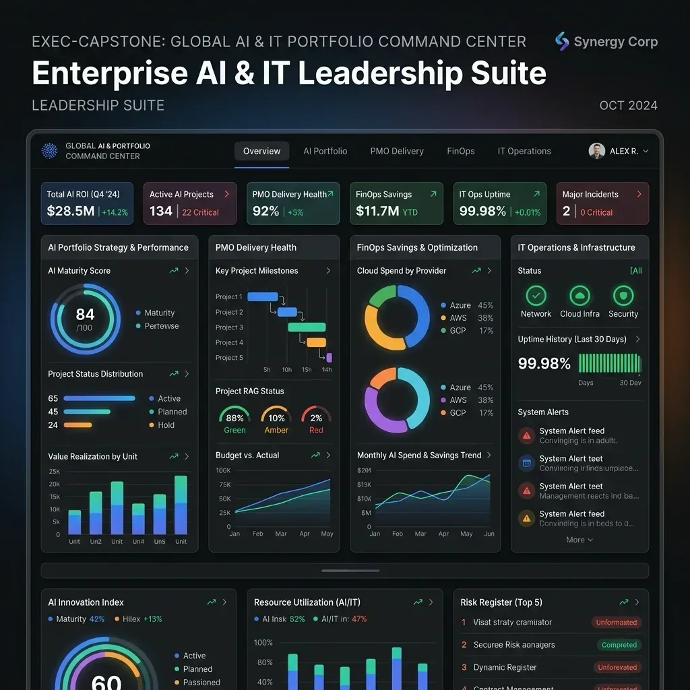
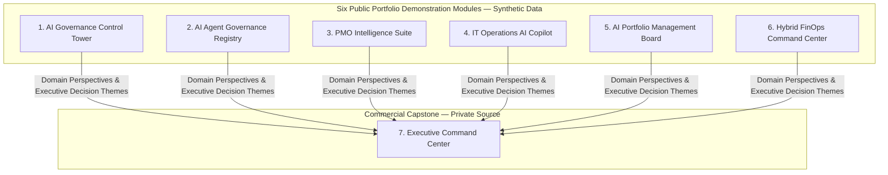
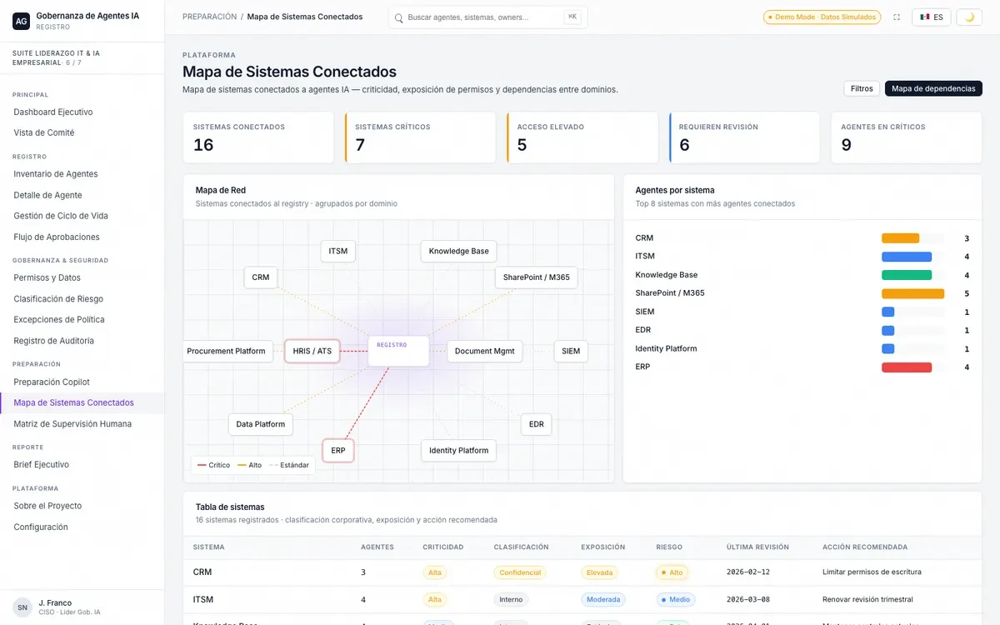
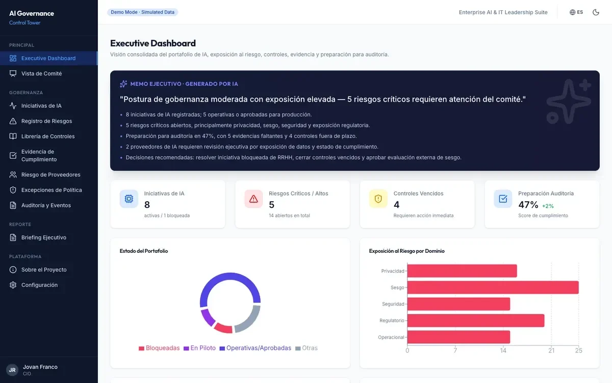
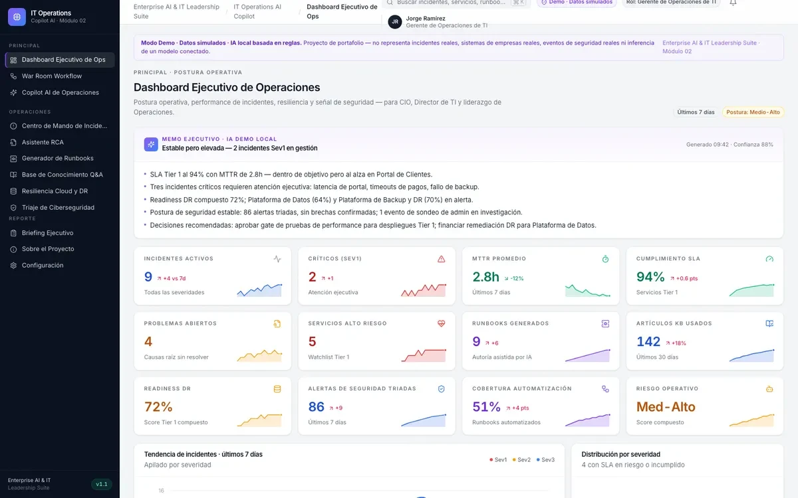
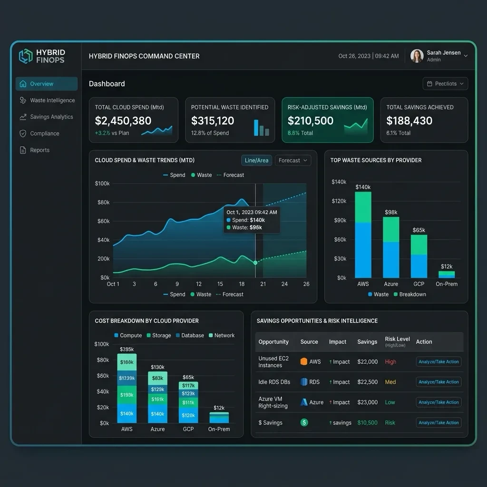

# Executive AI & IT Leadership Suite

  

  <strong>Executive decision-support portfolio across AI governance, agent oversight, PMO, IT operations, AI investment and hybrid FinOps.</strong> 
  Six public demonstrations connected by the operating model of Executive Command Center.

  <a href="https://github.com/jovfranco-tech"><strong>Jovan Franco — GitHub Profile</strong></a> •
  <a href="https://www.jovanfranco.com"><strong>Website & Executive Insights</strong></a> •
  <a href="https://executive-command-center-one.vercel.app/"><strong>Executive Command Center Landing</strong></a>

---

## Product Purpose & Problem Statement

Enterprise technology leaders (CIOs, CAIOs, CISOs, VPs of PMO, and FinOps Directors) routinely face fragmented visibility across AI risk registers, autonomous agent permissions, delivery bottlenecks, operational incident triage, strategic AI funding, and hybrid cloud/license waste.

The **Executive AI & IT Leadership Suite Showcase** solves the executive communication and operating-model alignment problem by consolidating six domain-specific public portfolio demonstrations and a commercial capstone concept into a unified architectural overview. This repository serves strictly as a **documentation-and-assets-only portfolio showcase** (`SHOWCASE_CANONICAL`) pointing to independently hosted external demonstrations using synthetic data.

---

## Repository Scope vs. External Deployments

> [!NOTE]
> **Documentation-Only Showcase Boundary (`HEAD`):**
> Per [SECURITY.md](SECURITY.md) and [ALORIA_PRODUCT_STATE.yaml](ALORIA_PRODUCT_STATE.yaml), this repository contains **no executable application source code, no build manifests, no API routes, no database schemas, and no automated test suites**. All `11` tracked files in `HEAD` are documentation, governance contracts, and static `.webp` visual previews. Live interactive demonstrations are hosted externally on Vercel and rely on representative synthetic datasets.

| Surface / Artifact | Location | Verified State in `HEAD` |
| :--- | :--- | :--- |
| Executive Portfolio Documentation | [README.md](README.md) | Present in repository |
| Security & Responsible Disclosure Policy | [SECURITY.md](SECURITY.md) | Present in repository |
| Canonical Product State Contract | [ALORIA_PRODUCT_STATE.yaml](ALORIA_PRODUCT_STATE.yaml) | Present in repository (`SHOWCASE_CANONICAL`) |
| Suite & Module Visual Previews (`8` files) | [assets/suite-architecture.webp](assets/suite-architecture.webp) & `assets/*.webp` | Present in repository (`8/8` assets verified) |
| Six Public Interactive Web Demos | External (`*.vercel.app`) | Hosted outside this repository |
| Commercial Capstone Source (`Executive Command Center`) | Private Commercial Repository | Not stored in this repository (`PRIVATE_COMMERCIAL_SOURCE`) |

---

## Executive Portfolio Snapshot

| Decision domain | Portfolio demonstration | Primary executive question |
| :--- | :--- | :--- |
| **AI governance** | [AI Governance Control Tower](https://ai-governance-control-tower.vercel.app/) | Which AI initiatives require stronger controls, evidence or human oversight? |
| **Agent governance** | [AI Agent Governance Registry](https://ai-governance-registry.vercel.app/) | Who owns each agent, what can it access and where must a human approve? |
| **Transformation delivery** | [PMO Intelligence Suite](https://pmo-intelligence-suite.vercel.app/) | Which programs are drifting, blocked or consuming capacity without progress? |
| **Technology operations** | [IT Operations AI Copilot](https://it-operations-ai-copilot.vercel.app/) | Which incidents and resilience gaps require immediate leadership attention? |
| **AI portfolio investment** | [AI Portfolio Management Board](https://ai-portfolio-management-board.vercel.app/) | Which AI initiatives best align investment, risk and expected value? |
| **Hybrid infrastructure economics** | [Hybrid FinOps Command Center](https://hybrid-finops-cc.vercel.app/dashboard) | Where is recoverable waste concentrated across cloud, virtualization and licenses? |

### What this portfolio demonstrates

- Translation of complex technology signals into executive decisions.
- Governance models with explicit ownership, controls, evidence and human authority.
- Product thinking across risk, operations, finance, PMO and investment portfolios.
- Interactive systems built to communicate architecture and operating models clearly.
- Responsible portfolio boundaries using synthetic data and explicit maturity labels.

---

## Architecture & Operating Model

The **Executive AI & IT Leadership Suite** bridges domain-specific operational tools and C-suite decision support. Six specialized public portfolio demonstrations provide focused visibility into AI risk, agent autonomy, PMO delivery, SecOps triage, AI portfolio alignment and cloud FinOps.

The six demonstrations illustrate perspectives consolidated within the **Executive Command Center** operating model—an integrated, private-source commercial decision-support platform for alignment across technology risk, operations, finance and strategy.

> [!NOTE]
> **Conceptual domain consolidation:** The six public demonstrations operate independently with synthetic dataset fixtures. The diagram represents conceptual and operating-model alignment, not active production integrations, shared live databases or streaming telemetry pipelines.

---

## Six Public Portfolio Demonstration Modules

> [!IMPORTANT]
> **Scope of Capability Claims:** The capabilities listed under each module below describe the functional scope presented by the **external live Vercel demonstrations** and their corresponding previews in `assets/`. Because the source code and tests for those applications reside in separate repositories outside `executive-ai-it-leadership-suite-showcase`, runtime implementation details are not directly verifiable from files in this repository.

### Module 1: AI Governance Control Tower

  

- **Live Interactive Demo**: **[Open AI Governance Control Tower](https://ai-governance-control-tower.vercel.app/)**
- **Business Problem**: Enterprise difficulty in systematically scoring AI use-case risk, mapping controls, tracking policy exceptions and preparing for governance audits.
- **Intended Audience**: Chief AI Officers, Chief Risk Officers and Enterprise Risk Committees.
- **Showcased Capabilities (External Demo Scope)**: ISO/IEC 42001-inspired intake scoring, risk tiering, policy exception tracking, third-party vendor risk scorecards and structured evidence ledgers.
- **Product Maturity**: Portfolio Prototype — ISO/IEC 42001-inspired functional scope.
- **Synthetic Data Scope**: Representative synthetic data; no real tenant metrics or guaranteed statutory compliance.

---

### Module 2: AI Agent Governance Registry

  

- **Live Interactive Demo**: **[Open AI Agent Governance Registry](https://ai-governance-registry.vercel.app/)**
- **Business Problem**: Proliferation of autonomous AI agents, tool-calling permissions and insufficient human oversight gates.
- **Intended Audience**: CISOs, AI Platform Architects and IT Governance Directors.
- **Showcased Capabilities (External Demo Scope)**: Agent inventory, permission boundaries, risk classification, lifecycle state transitions and escalation logs.
- **Product Maturity**: Portfolio Prototype — Agent Risk Framework.
- **Synthetic Data Scope**: Synthetic agent configurations and browser-local state; no live enterprise IAM enforcement.

---

### Module 3: PMO Intelligence Suite

  

- **Live Interactive Demo**: **[Open PMO Intelligence Suite](https://pmo-intelligence-suite.vercel.app/)**
- **Business Problem**: Fragmented visibility across predictive, agile, hybrid and AI/ML project delivery pipelines.
- **Intended Audience**: VPs of PMO, Program Directors and Transformation Leaders.
- **Showcased Capabilities (External Demo Scope)**: Milestone velocity scoring, risk indicators, bottleneck identification and cross-project resource allocation.
- **Product Maturity**: Portfolio Demonstration — PMO Risk & Velocity.
- **Synthetic Data Scope**: Simulated project telemetry.

---

### Module 4: IT Operations AI Copilot

  

- **Live Interactive Demo**: **[Open IT Operations AI Copilot](https://it-operations-ai-copilot.vercel.app/)**
- **Business Problem**: Extended incident triage timelines and SecOps operational overload.
- **Intended Audience**: IT Operations Directors, Infrastructure Managers and SecOps Leads.
- **Showcased Capabilities (External Demo Scope)**: Incident triage, disaster recovery readiness, operational briefings and context-aware resolution guidance.
- **Product Maturity**: Portfolio Demonstration — SecOps & Incident Triage.
- **Synthetic Data Scope**: Simulated incident logs and infrastructure alerts.

---

### Module 5: AI Portfolio Management Board

  

- **Live Interactive Demo**: **[Open AI Portfolio Management Board](https://ai-portfolio-management-board.vercel.app/)**
- **Business Problem**: Misalignment between strategic enterprise goals and tactical AI initiative funding.
- **Intended Audience**: CIOs, Strategy Directors and Investment Committees.
- **Showcased Capabilities (External Demo Scope)**: AI investment prioritization, value-realization tracking, strategic alignment scoring and portfolio balancing.
- **Product Maturity**: Portfolio Demonstration — AI Portfolio Scoring.
- **Synthetic Data Scope**: Representative financial models and synthetic initiative scores.

---

### Module 6: Hybrid FinOps Command Center — Portfolio Demonstration

  

- **Live Interactive Demo**: **[Open Hybrid FinOps Command Center](https://hybrid-finops-cc.vercel.app/dashboard)**
- **Business Problem**: Unidentified waste across hybrid cloud, virtualization, storage and collaboration-license footprints.
- **Intended Audience**: CIOs, FinOps Directors and Cloud Operations Leads.
- **Showcased Capabilities (External Demo Scope)**: Cross-domain waste scoring, risk-adjusted recoverable savings, opportunity management and execution-asset generation.
- **Product Maturity**: Portfolio Demonstration — Hybrid Waste Intelligence.
- **Synthetic Data Scope**: Synthetic telemetry exports and browser-local state.

> [!NOTE]
> **FinOps product boundary:** `Hybrid FinOps Command Center — Portfolio Demonstration` is distinct from `Hybrid FinOps Savings Copilot — Commercial Product`, whose source and implementation remain private.

---

## Commercial Capstone: Executive Command Center

  

- **Executive Landing Page**: **[Open Executive Command Center Landing Page](https://executive-command-center-one.vercel.app/)**
- **Commercial Classification**: `PUBLIC_COMMERCIAL_LANDING` • `FULL_APP_PROTECTION_PENDING` • `PRIVATE_COMMERCIAL_SOURCE` • `INTEGRATED_COMMERCIAL_PLATFORM`

**Executive Command Center** is the commercial capstone designed to consolidate decision-support perspectives across the six portfolio domains into one executive interface. It is intended for enterprise CIOs, CAIOs, CISOs and board committees reviewing risk, operational health, financial efficiency and portfolio execution.

### Consolidated perspectives

- **CAIO / Risk Committee**: AI risk posture and ISO/IEC 42001-inspired governance readiness.
- **CIO / Operations Leadership**: Operational health, PMO delivery velocity and hybrid FinOps recovery themes.
- **CISO / Resilience Leadership**: Security posture, vendor risk and incident-readiness concepts.

### Private access and protection boundary

Commercial source code, backend schemas, proprietary scoring heuristics and internal administration or operational routes remain private. Enterprise decision-makers may request a protected demonstration through the official landing page. Note that `FULL_APP_PROTECTION_PENDING` remains an open external commercial milestone outside this showcase repository.

---

## Technology Stack, Integrations & External Dependencies

- **Verified Contents in This Repository (`HEAD`)**:
  - Documentation and governance files: [README.md](README.md), [SECURITY.md](SECURITY.md), and [ALORIA_PRODUCT_STATE.yaml](ALORIA_PRODUCT_STATE.yaml).
  - Static visual assets (`8` `.webp` previews under `assets/`).
  - `0` source code files, `0` `package.json` or language manifests, and `0` runtime build dependencies inside this repository.
- **External Live Demonstrations & Sibling Repositories**:
  - Public showcase links point to seven external Vercel deployments (`ai-governance-control-tower.vercel.app`, `ai-governance-registry.vercel.app`, `pmo-intelligence-suite.vercel.app`, `it-operations-ai-copilot.vercel.app`, `ai-portfolio-management-board.vercel.app`, `hybrid-finops-cc.vercel.app`, and `executive-command-center-one.vercel.app`).
  - No live telemetry pipelines, shared databases, or automated cross-app integrations exist inside this showcase repository.

---

## Local Setup, Environment Variables & Data Model

- **Installation & Local Execution**:
  - Because this repository contains **no `package.json`, source code, or runnable scripts**, no dependencies need to be installed and no local development server can be launched from a checkout of this repository.
- **Environment Variables**:
  - None required or referenced (`0` `.env.example` files and `0` environment variable references in `HEAD`).
- **Data Model & Migrations**:
  - None in this repository (`0` database schemas and `0` migration files in `HEAD`). All visual previews depict synthetic portfolio fixtures (including illustrative placeholder labels such as `Synergy Corp` in the executive UI mockup).

---

## Testing, Quality & Security Posture

- **Automated Tests & CI/CD Workflows**:
  - `0` test files and `0` `.github/workflows/*` files exist in this repository (`NOT_STARTED` / not applicable for a documentation-only showcase).
- **Documentation & Governance Verification**:
  - Canonical repository state is tracked in [ALORIA_PRODUCT_STATE.yaml](ALORIA_PRODUCT_STATE.yaml) (`canonical_main_status: CANONICAL_ACCEPTED`, `exact_sha_validation_required: true`).
  - `README.md` structure, Mermaid syntax, secret-pattern hygiene, and relative file links were validated locally via `validate_readme.py`.
- **Security & Privacy ([SECURITY.md](SECURITY.md))**:
  - **Zero Live Secrets or Credentials**: Verified that `HEAD` contains no API keys, tokens, `.env` files, or cloud configurations.
  - **Synthetic Data Only**: Visual assets and descriptions reflect synthetic portfolio data with zero real personal, client, or employer records.
  - **Responsible Disclosure**: Security or disclosure reports may be submitted via [https://www.jovanfranco.com](https://www.jovanfranco.com) or GitHub Private Vulnerability Reporting (when enabled).

---

## Roadmap, Pending Scope & Portfolio Reconciliation (`2026-11-23`)

### Global Roadmap Cross-Check

- **`AEAS_PORTFOLIO_ROADMAP_REGISTER_20261120.md` (Section 4.2)**: Classifies `executive-ai-it-leadership-suite-showcase` among `15` repositories under **Showcases, Sandboxes, Labs, Websites & Demos** (*Non-production showcases/websites/demos; verify zero live secrets or unapproved PII/claims*).
- **Scope Separation**: Underlying product repositories (`ai-portfolio-management-board`, `it-operations-ai-copilot`, `ai-agent-governance-registry`, `hybrid-finops-command-center`, `executive-command-center`) are tracked separately under *Adjacent Vertical Products, Command Centers & SaaS Prototypes* in `AEAS_PORTFOLIO_ROADMAP_REGISTER_20261120.md`. This showcase repository does not appear in `AEAS_TOTAL_GLOBAL_COMPLETION_SCORECARD_20261121.json` or `AEM_MASTER_ROADMAP_RECONCILIATION_2026-10-22.md`.
- **Evidence Boundary ([ALORIA_PRODUCT_STATE.yaml](ALORIA_PRODUCT_STATE.yaml))**: `main_is_not_production_claim: true`, `technical_gold_is_not_third_party_certification: true`, `commercial_proof_is_separate: true`. This repository is explicitly **not** `PRODUCTION_READY` as a software system because it is a documentation showcase.

### Track-by-Track Reconciliation

| Track / Component | Status | Scope & Verified Evidence (`2026-11-23`) |
| :--- | :--- | :--- |
| Showcase Documentation, Security Policy & State Contract | `IMPLEMENTED` / `VERIFIED` | `11/11` tracked files (`100%` of showcase repository scope: `README.md`, `SECURITY.md`, `ALORIA_PRODUCT_STATE.yaml`, `8` `assets/*.webp`, verified `2026-11-23` against `HEAD`); PRs `#1`–`#4` merged. |
| External Public Interactive Demonstrations (`6` Modules) | `PARTIALLY_IMPLEMENTED` | Live demo URLs are linked in this showcase, while their source code, runtime behavior, and automated tests reside outside this repository and are unverified here. |
| Executive Command Center Commercial Capstone & Full Protection | `BLOCKED_EXTERNAL` | Landing page linked externally; `FULL_APP_PROTECTION_PENDING` and `PRIVATE_COMMERCIAL_SOURCE` mean full commercial implementation and verification sit outside this public repository. |
| Executable Source Code, Automated Tests & CI/CD in This Repo | `NOT_STARTED` | Intentionally excluded (`0` source files, `0` test files, `0` `.github/workflows`); repository is strictly documentation-only by design and not `PRODUCTION_READY`. |

---

## Deployment & Operations

- **This Repository**: Static Markdown documentation and `.webp` asset hosting on GitHub (`main` branch). No deployment manifests, infrastructure-as-code files, or CI/CD runners are hosted here.
- **External Showcase Targets**: The six portfolio modules and the Executive Command Center landing page are hosted externally on Vercel (`*.vercel.app`) outside the scope of this repository.

---

## Verified Repository Links

- [README.md](README.md) — Executive showcase documentation and reconciliation overview
- [SECURITY.md](SECURITY.md) — Security & responsible disclosure policy
- [ALORIA_PRODUCT_STATE.yaml](ALORIA_PRODUCT_STATE.yaml) — Canonical product state contract (`2026-10-07`)
- [assets/suite-architecture.webp](assets/suite-architecture.webp) — Suite architecture overview graphic
- [assets/module-01-governance.webp](assets/module-01-governance.webp) — Module 1 visual preview
- [assets/module-02-agent-registry.webp](assets/module-02-agent-registry.webp) — Module 2 visual preview
- [assets/module-03-pmo.webp](assets/module-03-pmo.webp) — Module 3 visual preview
- [assets/module-04-it-operations.webp](assets/module-04-it-operations.webp) — Module 4 visual preview
- [assets/module-05-portfolio.webp](assets/module-05-portfolio.webp) — Module 5 visual preview
- [assets/module-06-finops.webp](assets/module-06-finops.webp) — Module 6 visual preview
- [assets/executive-command-center-preview.webp](assets/executive-command-center-preview.webp) — Executive Command Center visual preview

---

## Intellectual Property & Responsible Disclosure

© Jovan Franco. All Rights Reserved.  
This repository is provided as a public portfolio showcase and architectural overview. Reproduction, redistribution or commercial use without prior written consent is prohibited.
